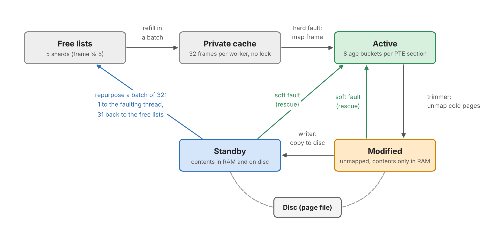
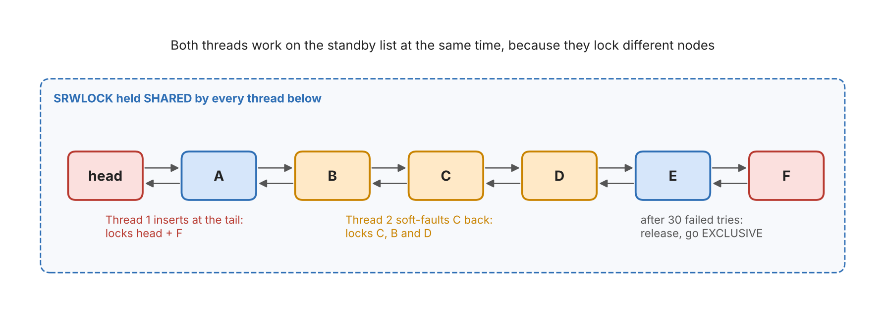
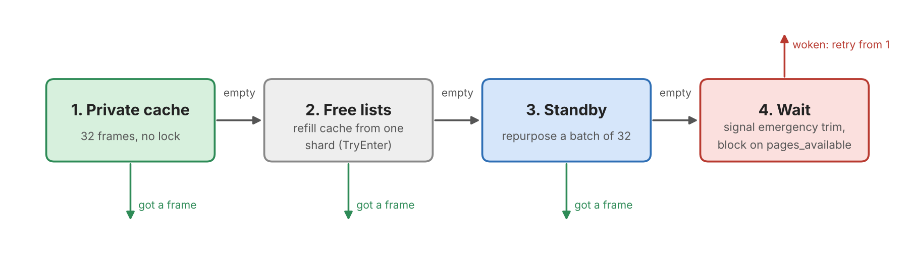
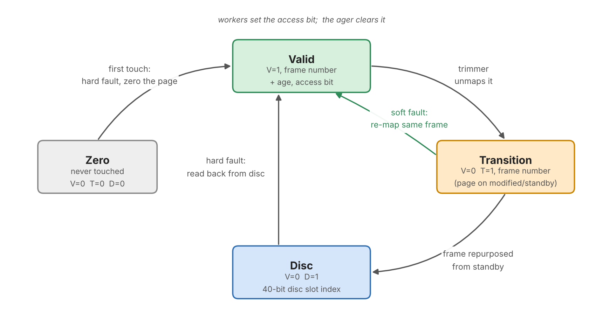
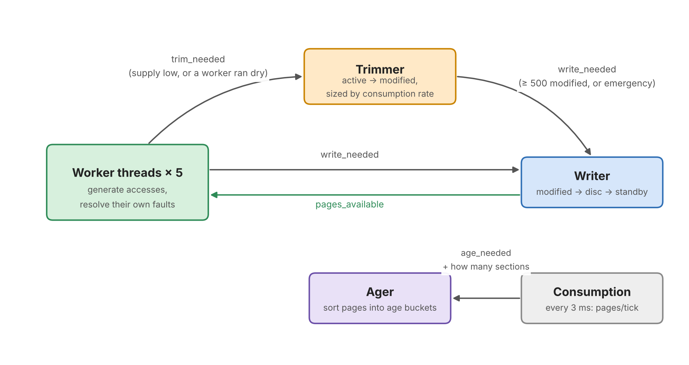
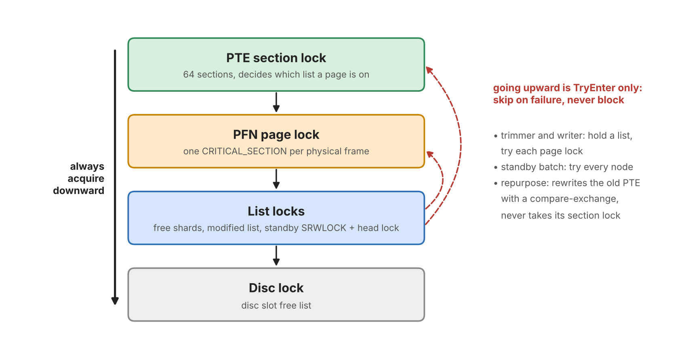

# A Multithreaded User-Mode Virtual Memory Manager

By Olivia Cheng, Summer 2026. Reach out with questions at **[your email]**.

## The Goal

I wanted to build my own version of the memory manager inside Windows: the part of the operating system that lets every program act as if it has far more memory than the machine actually has.

To do that, I reserve a large range of virtual addresses and don't back it with any physical memory. Worker threads then write to that range in a loop. Each time they touch a page that isn't mapped, the CPU raises a page fault, and my code has to resolve it as fast as possible. Pages get mapped in until physical memory runs out. Then the coldest ones are unmapped and written to a simulated disc so their frames can be reused. When a thread touches one of those addresses again, its contents have to come back exactly as they were.

All of this runs in user mode. Windows provides only three primitives:

| Windows API | What I use it for |
|---|---|
| `AllocateUserPhysicalPages` | A private pool of real physical pages (1 GB by default) |
| `VirtualAlloc2` with `MEM_RESERVE \| MEM_PHYSICAL` | Virtual address space with nothing behind it (about 3 GB) |
| `MapUserPhysicalPages` / `MapUserPhysicalPagesScatter` | Connect or disconnect a virtual page and a physical page, which is my version of the valid bit |

The page table, the PFN database, the page lists, aging, trimming, the disc writer, and the fault handler are all mine.

At the end of every run, `check_accuracy()` walks the entire address space and checks that every page still holds exactly what was written to it, whether the page is mapped, in transition, or on disc.

## Roadmap

### Single Threaded State Machine

I started with a single thread so I could learn every state a page can be in before adding the complication of concurrency. The four building blocks were page table entries (PTEs), PFN metadata, linked lists, and the disc.

**PTEs.** Each virtual page has a 64-bit PTE. I declare three layouts for those 64 bits and read them through a union, so the same 8 bytes are interpreted according to the page's current state:

```c
VALID_PTE       valid:1  frame_number:40  age:3  access:1  reserved:19
TRANSITION_PTE  valid:1  transition:1  frame_number:40  reserved:22
DISC_PTE        valid:1  transition:1  disc:1  disc_index:40  reserved:21
```

I use 40 bits for the frame number because physical addresses are 52 bits, and the low 12 bits are only the offset inside a 4 KB page. That leaves 40 bits to name the page itself. Once a page has been sent to disc, those same 40 bits hold its disc slot instead, so a later fault knows where to read it back from.

**PFN metadata.** Each physical page has a `pfn_metadata` struct recording which list it's on, which PTE owns it, which disc slot holds a copy, and whether it's being written right now. I store all of them in one array indexed by frame number. That makes frame number → metadata an array lookup and metadata → frame number a pointer subtraction, so I never have to search for a page.

**Lists and disc.** I started with an active list of mapped pages and a free list of unused ones. The active list keeps itself sorted by age, so the oldest page is always at the head. The disc is a large block of memory. Writing a page is a `memcpy` into a free slot, and reading it back is a `memcpy` out.

With those pieces, a fault worked like this: find the PTE, take a free page (or evict the oldest active page to disc), fill the page with the right contents, and set the PTE valid.

### Basic Multithreaded Machine

Once I understood the state machine, the question was which work to move off the faulting thread. Trimming (unmapping pages) and writing (copying them to disc) were the most expensive jobs, and they form a natural pipeline. So each got its own thread, while several worker threads generate faults at once.

That created pages that were in between states, so I added two lists:

- **Modified:** unmapped from its address, but its contents exist only in RAM, so it still has to be written to disc.
- **Standby:** its contents are on disc *and* still in RAM.

Because pages on both lists still hold valid data, a fault on the old address can simply map the same page again with no disc read. That's a **soft fault**. A standby page can also be **repurposed** for a different address, but only after the old owner's PTE is switched to disc format so it knows where its data went.

Multiple threads also meant I needed a **lock hierarchy**. A thread always has to read a PTE to know which list a page is on, so PTE locks go first, then page locks, then list locks, and the disc lock last because it's self-contained. When an operation genuinely needs to go the other direction, it uses `TryEnterCriticalSection` and skips on failure instead of blocking out of order.



### Complex Multithreaded State Machine

The basic version was correct, but adding threads didn't make it faster. From that point on I worked in the same loop each time: run a performance trace with xperf and WPA, find where threads were waiting on each other, fix that one bottleneck, and trace again. The sections below follow the order I did them in.

#### PTE Sections

The first trace made the biggest problem obvious: every fault was fighting over a single page-table lock. One lock per PTE would have been far too many, so I compromised and split the page table into 64 sections. Each section has its own lock, its own age lists, and its own counters, and finding a PTE's section is just `index / ptes_per_section`. Two threads faulting in different sections no longer contend, and one lock still covers a large slice of the table.

#### Specific List Locks

Next was the single PFN lock that guarded every list. A thread touching the free list would block a thread that only needed the modified list. I gave the free, modified, and active lists their own locks. While I was at it, I changed the trimmer and writer so they only run when there's real work for them. The trimmer waits until free + standby pages are actually low. The writer waits until it has a full batch of modified pages, or until supply is critically low. Threads now only wait on each other when they really need the same list, and the background threads stop waking up just to do almost nothing.

#### The Bug That Reshaped My Design

The most important debugging session of the project started with a trace showing `handle_hard_fault` constantly waiting on the `pages_available` event. That meant either my trimming and aging were too slow, or my batch sizes and triggers were wrong. When I printed statistics for the trimmer and writer, I found the writer was writing a **single page to disc at a time**.

Working backward explained why. Pages were never returned to the free list after startup, and standby pages were used up the moment they appeared. So free + standby was always low, every trim and write counted as an emergency, and in an emergency the writer ignores its batch size. On top of that, the disc was always full. That changed the question I was asking. With this many virtual addresses, a full disc is unavoidable, so what really matters is choosing better pages to trim. Looking at my aging, I found the real bug: I never reset a page to "hottest" after it was accessed. The trimmer kept evicting pages that were in active use, they faulted right back in, and the cycle never broke.

I fixed it by giving aging its own thread. Putting aging inside the trimmer would have made emergencies worse, because a starving worker would end up waiting on aging instead of getting a page. I also added a consumption thread. It measures how fast pages are being used, estimates how many ticks remain before free + standby runs out, and sizes the next aging pass to match, so aging keeps up without running constantly. Finally, I added flags that track whether the trimmer and writer are already running, which cut out redundant `SetEvent` calls. With aging working, the trimmer evicts genuinely cold pages, those pages stay evicted, and trims start before workers run dry instead of after.

#### Peek Before You Lock

The next trace showed lock contention in `get_free_page`. Threads were taking the free-list lock just to find out the list was empty. Now I read the list's size *without* the lock first, go straight to standby if it's empty, and only take the lock when the list looks like it has pages. A stale read is harmless here because there's always a fallback, standby and then waiting, so threads stop lining up for a lock with nothing behind it.

#### Temporary VAs and Fewer Unmaps

Traces of `handle_hard_fault` and the disc writer showed a lot of time going to mapping calls, and unmapping turned out to cost more than mapping. I can't avoid the map calls, but I can avoid most of the unmaps. Each worker reserves 512 scratch virtual addresses. To read a page back from disc, it maps the page at the next free scratch address, copies the data in, and then maps it at its real address. The scratch mappings are only unmapped when all 512 have been used, and all at once in a single call. The writer works the same way, with one map for its whole batch and one unmap. Most disc faults now cost about one map call instead of a map and an unmap. It also helps correctness. The page is filled at a private address, so no other thread can see it half-written. I later limited this to disc faults only, since a brand-new page isn't visible to any other thread anyway.

#### The Access Bit

My goal here was to remove section locks from the worker's normal path entirely, since touching an already-mapped page is by far the most common thing a worker does. I added a hardware-style access bit to the PTE, the same signal a real CPU gives a real OS. A successful access just sets that bit with one `InterlockedCompareExchange64`. The ager reads it later: if the bit is set, the ager clears it and moves the page to bucket 0, and if not, the page moves one bucket older. I also switched other PTE updates from taking the section lock to compare-exchange.

Debugging this turned up two more problems. Aging was still only triggered once things were already an emergency, and when I dumped how many sections were being aged at once, it was 38 out of 64, which meant holding a lot of locks for a long time. So aging now runs periodically, with a minimum of 4 and a maximum of 20 sections per pass, so it never hogs locks even under pressure. Separately, the trimmer was skipping pages that were clearly on an age list. The age count had wrapped to a negative number, and switching the counters to `ULONG_PTR` fixed it.

I also gave the trimmer two passes. The fast pass skips hot pages and skips any section whose lock it can't get on the first try. Only if that doesn't free enough pages does the slow pass wait for every lock and take hot pages too. Touching a mapped page now takes no locks, and the trimmer stays out of the workers' way unless it really has to.

#### When Should an Interlocked Operation Retry?

After moving to compare-exchange, I went back through each one and decided whether it should retry when it fails. `set_access_bit` tries only once. If it fails, either the bit is already set or the trimmer just invalidated the page, and either outcome is fine. The ager loops until it succeeds, because it has to record the page's new age correctly. Repurposing also loops until the old PTE is in disc format, because skipping that step would lose the page's data.

#### Repurposing in Batches

Once free pages run out, every hard fault goes to standby, and every one of those trips takes the standby lock. So instead of repurposing a single page, a worker now takes a batch of 32, keeps one, and puts the other 31 on the free list. One trip to standby covers the next 31 faults too.

#### Sharded Free Lists

With repurposing batched, the single free list became the next hot lock. Unlike standby, a free list's order doesn't matter, since a free page is a free page. That made it safe to split it into one list per worker thread (frame number mod 5). During those traces I also noticed that my own trim and write timers were adding lock contention and system calls. I moved them behind a `DIAGNOSTICS` flag, so they're still available but cost nothing unless I'm measuring.

#### Trimmer and Writer in Parallel

`request_pages` used to wake the trimmer and writer one after the other, so the writer sat idle while the trimmer worked. Now it wakes both at once. I also moved the trim-size calculation into its own function that computes a fresh value every time. In an emergency it trims a fixed 400 pages to unblock workers quickly. Otherwise it trims whichever is larger: the deficit (how far supply is below the high watermark) or the demand gap (what the current consumption rate will need over the next 50 ticks), capped at 800. I added counters for emergency versus preemptive trims so I could see whether trims were landing on time.

#### Read/Write Locking on Standby

Standby is the list every thread wants: workers soft-faulting pages back, workers repurposing, and the writer adding newly written pages. It can't be split up like the free list, because its order matters, oldest first. Instead I replaced its single lock with an `SRWLOCK` that threads normally take in shared mode, plus a lock inside every node. To change a node, a thread locks only that node and its two neighbors. If it can't get them, it releases everything and waits a little, and the wait gets longer after each failure. After 30 failures it takes the whole list exclusively, which guarantees it eventually finishes. Threads working on different parts of standby no longer block each other.



#### A Private Free List for Every Thread

The last step was to get most faults off shared locks entirely. Each worker keeps its own cache of 32 free pages in thread-local storage and refills it from a shared free list in one batch, using `TryEnterCriticalSection` to skip any list that's busy. Most hard faults now get a page without taking any lock at all.



#### A Side Effect of Going Lock-Free

Updating PTEs with compare-exchange instead of locks had a consequence I had to handle. Even while I hold a PTE's section lock, repurposing can change that PTE underneath me. So `handle_soft_fault` now re-checks that the PTE is still in transition before acting, and if it isn't, it sends the fault back to be classified again. The same kind of lesson showed up inside the PFN struct. `isOccupied` and `write_in_progress` used to be bitfields sharing one word, so two threads writing different fields were overwriting each other's updates. Giving each its own field fixed it.

#### A Workload Worth Aging

Purely random access makes aging pointless: if every page is equally likely to be touched next, no page is really cold. So I changed the access generator to walk linear runs of 16 to 512 pages, and on half of its jumps to revisit one of the last 64 pages it touched. That gives the ager real hot and cold pages to tell apart, and it produces the soft faults that the modified and standby lists were built to serve.

## The Two State Machines

There are really two state machines running against each other: one for each **virtual page** and one for each **physical page**. Keeping them straight is most of the difficulty. A virtual page can be on disc while the physical page that used to hold it is already serving someone else.

### PTE State Machine



The same 40 bits mean different things depending on the state. In **Valid** and **Transition** they hold a frame number. In **Disc** they hold a page-file slot. A transition PTE doesn't store a disc slot even when one exists, because that lives in the PFN metadata.

### PFN State Machine

| `isOccupied` | State | Where the page is |
|---|---|---|
| 0 | Free | A free list or a worker's private cache |
| 1 | Active | An age bucket in its PTE section |
| 2 | Modified | The modified list |
| 3 | Standby | The standby list |

Standby is the most interesting state. It's the only one where the data exists in two places at once, which is what makes a standby page both cheap to rescue and safe to steal.

## Threads



| Thread | Wakes on | Job |
|---|---|---|
| Worker × 5 (`NUM_THREADS`) | runs continuously | Generate accesses, handle their own faults |
| `trim_thread` | `trim_needed` | Unmap cold pages, move them to modified |
| `write_thread` | `write_needed` | Copy modified pages to disc, move them to standby, signal `pages_available` |
| `age_thread` | `age_needed` | Sort pages into age buckets using the access bit |
| `consumption_thread` | every 3 ms | Measure page usage, size the next aging pass |

## The Fault Path

A worker takes the PTE's section lock and checks the state:

```
valid == 1        -> another thread already fixed it; retry the access
transition == 1   -> soft fault: take the page back off modified/standby
disc == 1         -> hard fault: read the page back in from disc
otherwise         -> hard fault: first touch, zero the page
```

If no page is available anywhere, the worker releases its section lock, signals an emergency trim, and blocks on `pages_available` until the writer has produced more pages.

## Lock Hierarchy



## Poaching

The writer marks each page `write_in_progress = 1` while holding its lock, then **releases the lock to do the `memcpy`**. If it held the lock, every fault on those pages would have to wait for the disc copy. During that window a worker can soft-fault on the page and take it back, which clears the flag.

When the writer finishes, it re-locks each page. If the flag survived, it records the disc slot and moves the page to standby. If the flag was cleared, its copy is already stale, so it frees the slot and leaves the page alone. Some work gets wasted, but nothing gets corrupted, and a fault never waits on disc I/O.

## Configuration

All settings are `#define`s at the top of `main.c`.

| Setting | Default | What it controls |
|---|---|---|
| `NUMBER_OF_PHYSICAL_PAGES` | 262,144 (1 GB) | Physical pages requested from Windows |
| `NUM_DISC_PAGES` | 2 × physical | Simulated page file size |
| `NUM_THREADS` | 5 | Worker threads and free-list shards |
| `NUM_PTE_SECTIONS` / `NUM_AGES` | 64 / 8 | Page-table sections, age buckets per section |
| `TRIM_LOW_BAR` / `TRIM_HIGH_WATERMARK` | phys/10, 5 × that | When to trim, and how far to refill |
| `TRIM_BATCH_SIZE` / `WRITE_BATCH_SIZE` | 800 / 500 | Max pages per trim, pages per disc write |
| `STANDBY_REFILL_BATCH` / `PERSONAL_FREE_LIST_SIZE` | 32 / 32 | Repurpose batch, per-thread cache |
| `TEMP_VA_SIZE` | 512 | Scratch addresses per worker |
| `AGE_MIN_SECTIONS` / `AGE_MAX_SECTIONS` | 4 / 20 | Range for the adaptive aging batch |
| `RW_LIST_MAX_FAILS` | 30 | Shared-lock retries before going exclusive |
| `DEBUG` / `DIAGNOSTICS` | 1 / 0 | Asserts and prints / timing counters |

## Building and Running

You need Windows, MSVC, CMake, and the **Lock Pages in Memory** privilege. To grant it, open `secpol.msc` → Local Policies → User Rights Assignment, add your user to *Lock pages in memory*, then sign out and back in.

```
cmake -B build
cmake --build build --config Release
build\Release\vmTest.exe
```

Set `DEBUG` to 0 for timing runs.

## Where This Goes Next

- **Lock-free disc allocator:** replace the disc free list and its lock with a bitmap claimed using `_interlockedbittestandset64`.
- **Zero thread:** zero pages in the background so first-touch faults don't pay for a `memset`.
- **Speculative reads:** a disc fault in the middle of a linear run means the next pages are coming, so read several pages at once.
- **Clean pages:** skip rewriting pages that haven't changed since their last trip to disc.
- **Split `main.c`** into modules.

## Acknowledgments

Thanks to my mentor at Microsoft for guiding me through this all summer, and to Lily Kassaei, Noah Persily, and Landon Moceri, whose memory managers I learned from. The per-thread XOR-shift random number generator is adapted from Noah's.
